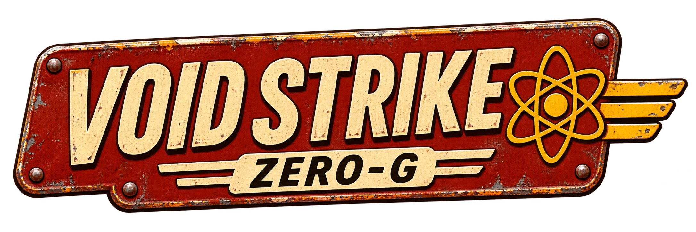
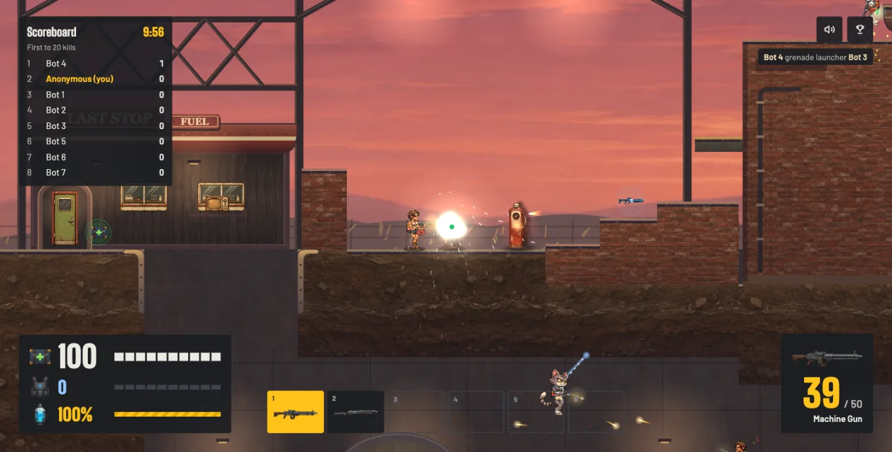

<h1 align="center">
  
</h1>

<p align="center">A fast 2D arena shooter with jetpacks, grappling hooks, and destructible cover.</p>

<p align="center">
  <a href="https://aleksejbjs.github.io/void-strike-zero-g/"><strong>Play in your browser</strong></a>
  · <a href="CHANGELOG.md">Changelog</a>
  · <a href="server/README.md">Dedicated server</a>
</p>

[](https://aleksejbjs.github.io/void-strike-zero-g/)

## New in 0.5.2 · Last Stop

Fight across a retro gas station, from the rooftops to the service basement. Three shafts let you switch levels, the workshop shield breaks a long firing lane, and fuel pumps explode when destroyed.

Select **Deathmatch → Last Stop → Play vs bots** to try it with seven bots. A dedicated server can host up to eight human players. See the [release history](CHANGELOG.md#version-052-2026-11-20) for details.

## Ways to play

| Play style | In-game options |
| --- | --- |
| **Solo** | Play offline against bots that look for weapons, take cover, and pursue mode objectives. |
| **With friends** | Host a browser room and share its invite link, or join a dedicated server. |
| **Competitive** | Enter 1v1 tournaments on The Pit, watch live matches, and track XP, wins, and other stats on the leaderboards. |

Choose from Deathmatch, Gun Game, Capture the Flag, Hold the Flag, Infiltration, Hunger Games, and 1v1 tournament duels.

## Combat and controls

- Jump, double-jump, fly with a jetpack, swing on a grappling hook, crouch, or go prone. Default keys include **WASD** for movement, **Space** for jump, and **right click** to grapple. Rebind actions in **Profile → Controls**.
- Use nine weapons, from the starting machine gun to the railgun, chainsaw, and flamethrower. Hit zones, wounds, ragdolls, and burning fuel tanks shape how fights play out.
- Fight around wooden and metal crates, glass, explosive barrels, and the fuel pumps on Last Stop. Destructible cover returns after 35 seconds.
- Build a fighter from illustrated parts, colours, patterns, and visor effects. Use an account to sync XP, achievements, and lifetime stats across devices.

Mobile play supports twin-stick touch controls and a touch-friendly HUD. The interface is available in English and Russian.

## Run locally

Use Node.js 20 or later.

```sh
npm ci
npm run dev
```

Open the URL printed by Vite. Run `npm test` for the test suite or `npm run build` for a production build. See the [dedicated server guide](server/README.md) for hosting and the [Supabase setup guide](docs/supabase-setup.md) for accounts and leaderboards.
